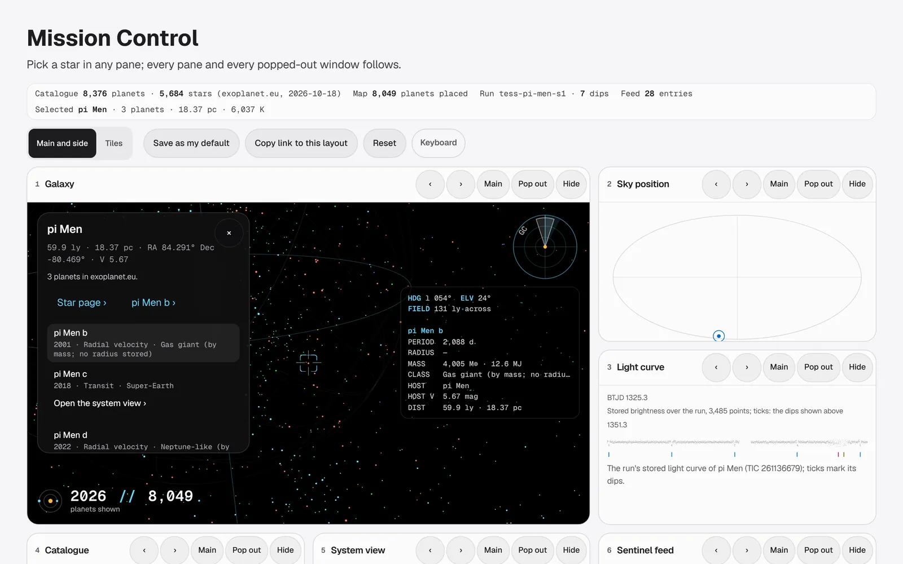
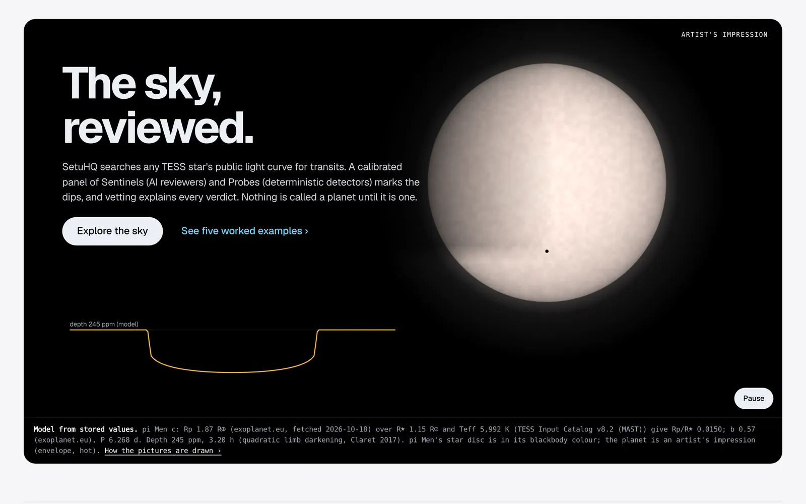
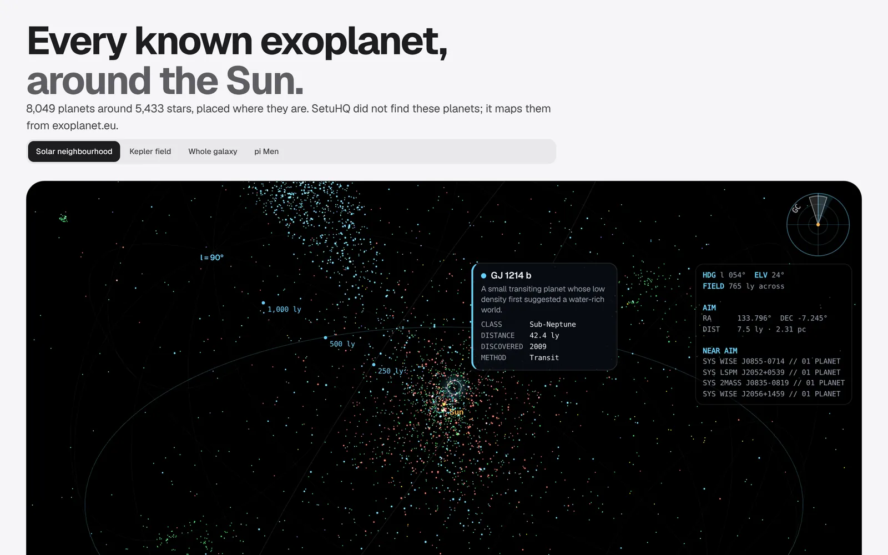
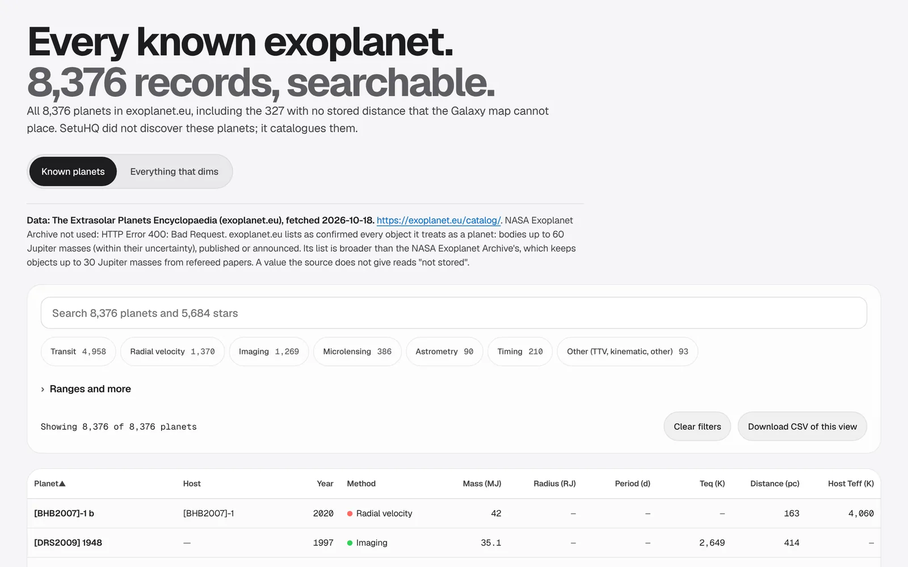
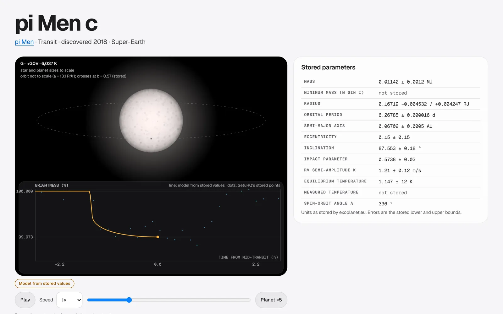
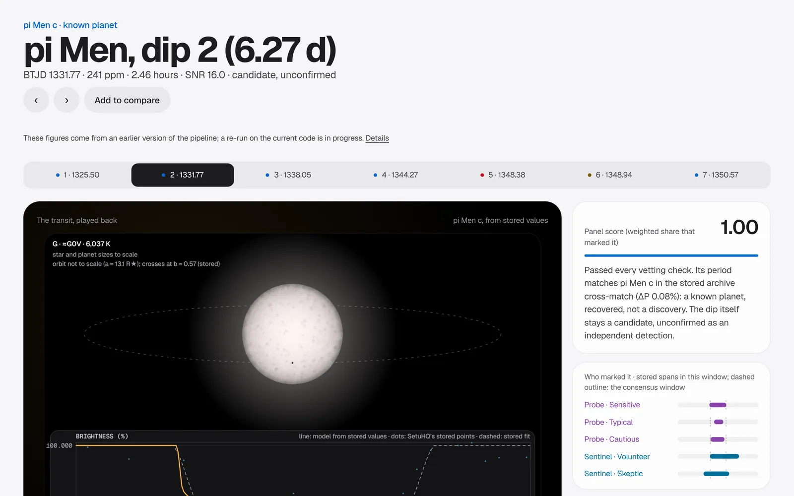
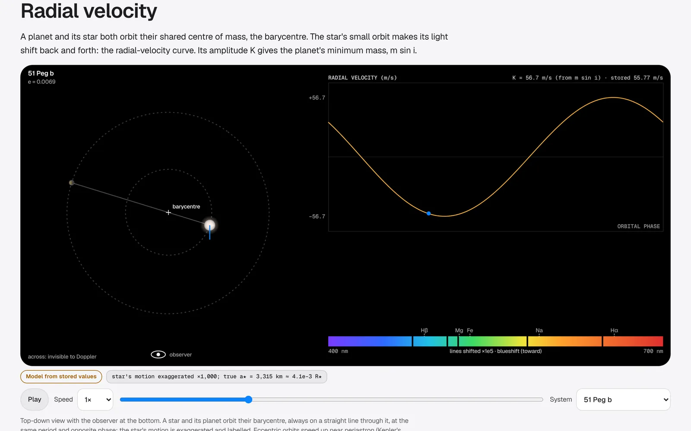
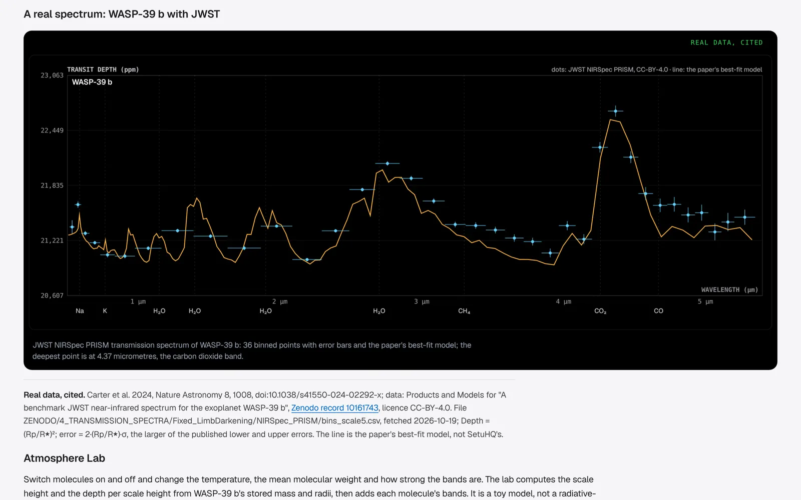
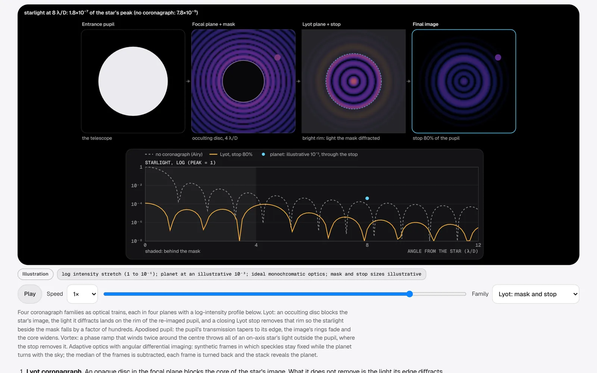

<!-- PREVIEW of the README for the public release of SetuHQ (formerly exoplan).
     Every figure under docs/assets/readme/ and every logo file under docs/assets/brand/ is
     generated from committed data by tools/gen_readme_assets.py, in light and dark variants,
     with every word outlined; each figure's alt text below is its own <desc>, word for word.
     Regenerate with `python3 tools/gen_readme_assets.py`; check with `--check` (run by
     scripts/ci_local.sh). The app screenshots under docs/assets/readme/app/ are taken from the
     built app by tools/capture_site_shots.mjs, imported with --import-shots and recorded in
     app/SHOTS.json (route, window, theme, frame, commit). -->

<p align="center">
  <picture>
    <source media="(prefers-color-scheme: dark)" srcset="docs/assets/brand/setuhq-logo-dark.svg">
    <source media="(prefers-color-scheme: light)" srcset="docs/assets/brand/setuhq-logo-light.svg">
    
  </picture>
</p>

<p align="center">
  <strong>SetuHQ · <span lang="sa">सेतु</span> · <em>the bridge</em></strong><br>
  The open exoplanet observatory: from public sky data to reviewed, explained candidates.
</p>

<!-- generated:badges by tools/gen_readme_assets.py --write-readme; edit the generator, not this block -->
<p align="center">
  <a href="scripts/ci_local.sh"></a>
  <a href="#evidence"></a>
  <a href="#the-app"></a>
  <a href="#the-app"></a>
  <a href="#licence"></a>
  <a href="#editions"></a>
</p>
<!-- /generated:badges -->

<p align="center">
  <a href="https://setuhq.com"><b>setuhq.com</b></a> ·
  <a href="#the-app">The app</a> ·
  <a href="#how-a-run-works">How it works</a> ·
  <a href="#evidence">Evidence</a> ·
  <a href="#quick-start">Quick start</a> ·
  <a href="#editions">Editions</a> ·
  <a href="#cite">Cite</a>
</p>

<picture>
  <source media="(prefers-color-scheme: dark)" srcset="docs/assets/readme/hero-dark.svg">
  <source media="(prefers-color-scheme: light)" srcset="docs/assets/readme/hero-light.svg">
  
</picture>

> **Preview.** This README is the draft for the public release. The product is being renamed
> from *exoplan* to **SetuHQ**: the Python package, the command and the app's own title are still
> `exoplan` until the release lands. Nothing on this page is a discovery claim: SetuHQ finds and
> vets *candidates*.

## Every dip in the sky, reviewed and explained

TESS has watched about 98% of the sky. Almost all of that light is public, and almost none of it
has been looked at dip by dip. SetuHQ does the looking: a **reviewer panel** of AI **Sentinels**
and deterministic **Probes** marks every dip in blind-coded light curves, the way Planet Hunters
volunteers do. Each verdict keeps its marks, its weights and, for the Sentinels, their reasons
in words. Then the pipeline does the physics: limb-darkened transit fits, bounded false-alarm
probabilities, odd/even and secondary checks, and an honest label on everything.

*Sentinels run on Claude (Anthropic). Probes are deterministic matched-filter detectors.*

**What SetuHQ is built to be:**

- **A search you can audit.** Every candidate carries its provenance: data hash, config hash,
  code fingerprint, every reviewer's marks.
- **A benchmark that keeps everyone honest,** including SetuHQ. A frozen, blind test on 662 real
  TESS candidates, with controls, a public leaderboard and its negative results printed first.
- **An observatory you can explore.** Every known exoplanet in 3D, a full catalogue, and
  fifteen animated chapters on how planets are found, all in one app.

## What's new in this preview

- **The name.** exoplan becomes SetuHQ, *setu* being Sanskrit for bridge: from public sky data
  to reviewed candidates. The logo's Q is a star with a planet crossing its face
  ([brand kit](docs/assets/brand/README.md)).
- **In review for this release** (on branches, each scored by an independent reviewer):
  pixel-level and Data-Validation-style vetting, a reduced false-positive probability with a
  stability gate, ExoFOP-style export (accepted, 9.0/10); a methods paper and a public
  leaderboard with a catalogue-metadata floor that SetuHQ does not yet beat (accepted, 9.0/10);
  the “everything that dims” catalogue and an all-sky sweep with contributor bundles (in review).

## The app

Every screenshot below is one frame rule: a 1440 × 900 window at twice the pixel density, motion
reduced so every drawing is at rest, cropped to the app's 1360 × 850 content frame (16:10)
starting just above the section shown. Light and dark follow your GitHub theme.

<picture>
  <source media="(prefers-color-scheme: dark)" srcset="docs/assets/readme/app/mission-dark.webp">
  <source media="(prefers-color-scheme: light)" srcset="docs/assets/readme/app/mission-light.webp">
  
</picture>

**Mission Control.** Six linked panes: the live Galaxy, the sky position, the light curve, a
catalogue slice with a star finder, the animated system view and the Sentinel feed. Selecting a
star in one pane selects it in every pane and in popped-out windows. Every number on the
telemetry strip is computed from the app's own data.

<table>
<tr>
<td width="50%" valign="top">

<picture>
  <source media="(prefers-color-scheme: dark)" srcset="docs/assets/readme/app/overview-dark.webp">
  <source media="(prefers-color-scheme: light)" srcset="docs/assets/readme/app/overview-light.webp">
  
</picture>

**Overview.** The landing page: what the panel is, and that nothing is called a planet until it
is one.

</td>
<td width="50%" valign="top">

<picture>
  <source media="(prefers-color-scheme: dark)" srcset="docs/assets/readme/app/galaxy-dark.webp">
  <source media="(prefers-color-scheme: light)" srcset="docs/assets/readme/app/galaxy-light.webp">
  
</picture>

**Galaxy.** 8,049 of exoplanet.eu's 8,376 planets placed in 3D around the Sun. The Milky Way is
an artist's impression drawn by the page; every planet position is data.

</td>
</tr>
<tr>
<td width="50%" valign="top">

<picture>
  <source media="(prefers-color-scheme: dark)" srcset="docs/assets/readme/app/catalogue-dark.webp">
  <source media="(prefers-color-scheme: light)" srcset="docs/assets/readme/app/catalogue-light.webp">
  
</picture>

**Catalogue.** All 8,376 exoplanet.eu records, 5,684 stars, a page for every one, and search
from anywhere (⌘K).

</td>
<td width="50%" valign="top">

<picture>
  <source media="(prefers-color-scheme: dark)" srcset="docs/assets/readme/app/planet-dark.webp">
  <source media="(prefers-color-scheme: light)" srcset="docs/assets/readme/app/planet-light.webp">
  
</picture>

**Planet pages.** Stored parameters with their bounds, and the system drawn to scale from
stored values, with SetuHQ's own points where it has them.

</td>
</tr>
<tr>
<td width="50%" valign="top">

<picture>
  <source media="(prefers-color-scheme: dark)" srcset="docs/assets/readme/app/transit-dark.webp">
  <source media="(prefers-color-scheme: light)" srcset="docs/assets/readme/app/transit-light.webp">
  
</picture>

**Transit cases.** SetuHQ's own dips, with the stored points, the limb-darkened fit and each
reviewer's marks.

</td>
<td width="50%" valign="top">

<picture>
  <source media="(prefers-color-scheme: dark)" srcset="docs/assets/readme/app/methods-rv-dark.webp">
  <source media="(prefers-color-scheme: light)" srcset="docs/assets/readme/app/methods-rv-light.webp">
  
</picture>

<!-- generated:methods-chapters by tools/gen_readme_assets.py --write-readme; edit the generator, not this block -->
**Methods: 15 chapters.** How a survey works, Transit, Toward and away, Radial velocity, Astrometry, Microlensing, Blocking starlight, Timing and phase, Radio, False positives, Reading atmospheres, Molecules and life, Population, Equations of life, History and papers. Physics checked by tests against closed forms and published values.
<!-- /generated:methods-chapters -->

</td>
</tr>
<tr>
<td width="50%" valign="top">

<picture>
  <source media="(prefers-color-scheme: dark)" srcset="docs/assets/readme/app/methods-atmospheres-dark.webp">
  <source media="(prefers-color-scheme: light)" srcset="docs/assets/readme/app/methods-atmospheres-light.webp">
  
</picture>

**Real data, labelled.** The real JWST spectrum of WASP-39 b (CO₂ at 4.37 µm), and an
Atmosphere Lab. Every visual says whether it is real data, a model or an illustration.

</td>
<td width="50%" valign="top">

<picture>
  <source media="(prefers-color-scheme: dark)" srcset="docs/assets/readme/app/methods-starlight-dark.webp">
  <source media="(prefers-color-scheme: light)" srcset="docs/assets/readme/app/methods-starlight-light.webp">
  
</picture>

**Coronagraphs, computed.** Lyot, apodised pupil, vortex and adaptive optics with angular
differential imaging, from real Fraunhofer numerics.

</td>
</tr>
</table>

<details>
<summary><b>More in the Methods chapters</b></summary>

<br>

* Physics checked by tests against closed forms and published values; the four below are drawn
  with the same functions.
* **Coronagraphs:** closing the Lyot stop from 150% to 80% cuts the starlight at 8 λ/D from
  6.7×10⁻⁵ to 1.8×10⁻⁷ of the peak.
* **Molecules, mode by mode.** Ten molecules, each vibration linked to its infrared band,
  infrared-silent modes marked, the amplitude exaggeration stated per mode.
* **Radial velocity:** a star and planet orbiting their barycentre, solved with Kepler's
  equation; the star's motion is drawn exaggerated by a stated factor.

</details>

## Capabilities

### A known planet, found blind and fitted

The stored run on pi Men (TESS sector 1): the panel's marks, the seven consensus dips and the
limb-darkened fit, against Huang et al. 2018.

<picture>
  <source media="(prefers-color-scheme: dark)" srcset="docs/assets/readme/pi-men-dark.svg">
  <source media="(prefers-color-scheme: light)" srcset="docs/assets/readme/pi-men-light.svg">
  
</picture>

### Where the sky has been watched

The survey footprints the Sky page draws, and how many planet hosts fall in each.

<picture>
  <source media="(prefers-color-scheme: dark)" srcset="docs/assets/readme/sky-coverage-dark.svg">
  <source media="(prefers-color-scheme: light)" srcset="docs/assets/readme/sky-coverage-light.svg">
  
</picture>

### How planets are found, computed

Four of the fifteen Methods chapters, drawn by the same functions the app uses and the tests
check.

<picture>
  <source media="(prefers-color-scheme: dark)" srcset="docs/assets/readme/methods-strip-dark.svg">
  <source media="(prefers-color-scheme: light)" srcset="docs/assets/readme/methods-strip-light.svg">
  
</picture>

## How a run works

<picture>
  <source media="(prefers-color-scheme: dark)" srcset="docs/assets/readme/flow-pipeline-dark.svg">
  <source media="(prefers-color-scheme: light)" srcset="docs/assets/readme/flow-pipeline-light.svg">
  
</picture>

<details>
<summary><b>Step by step</b></summary>

<br>

1. **Ingests** TESS SPOC light curves from MAST, CHEOPS light-curve FITS files, or CSV.
2. **Cleans and detrends**: spike clipping, a masked local-quadratic baseline, and binning.
3. **Cuts blind-coded subjects**: fixed 13-day segments with opaque IDs. The target name never reaches a reviewer.
4. **Runs the panel**: every reviewer marks and labels every subject independently. The task is the Planet Hunters task: mark the start and end of each dip, then label `potential_planet` or `noise`.
5. **Aggregates** marks by single-linkage clustering, scores each dip by the share of skill-weighted reviewers who marked it, and requires the panel to call the subject a potential planet.
6. **Vets** each consensus event: SNR, duration, edge effects, odd/even depth, secondary eclipse, and fit to the periodic ephemeris.
7. **Writes** a candidate catalogue (CSV and JSON), a Zooniverse-shaped classification export, a SQLite store, a provenance manifest, and a static report site.

</details>

<details>
<summary><b>The reviewer panel: Sentinels and Probes</b></summary>

<br>

| Reviewer kind | Shown as | What it is | Needs |
|---|---|---|---|
| `simulated` | **Probe** | Deterministic matched-filter detector with human-like limits (threshold, miss rate, boundary jitter). A baseline and a calibration reference. | Nothing |
| `claude_code` | **Sentinel** | Claude reviewing the rendered plot through the **Claude Code CLI**, which signs in with a Claude team or individual subscription. | `claude` on PATH, signed in |
| `claude` | **Sentinel** | Claude through the **Anthropic API** (vision). | `ANTHROPIC_API_KEY` |

The pages show display names; reviewer ids stay unchanged in every data file, CSV, JSON
and URL. The default panel is 2 Sentinels and 3 Probes: Sentinel · Volunteer
(`claude-volunteer`), Sentinel · Skeptic (`claude-skeptic`), and Probe · Sensitive,
Probe · Typical and Probe · Cautious (`volunteer-sensitive`, `volunteer-typical`,
`volunteer-cautious`).

Sentinels receive the same task as volunteers, the blind-coded plot, and no
target name. They return strict JSON, which is validated and clipped to the subject's
time range. A reviewer that is not available is skipped and listed in the manifest.
Responses are cached by a hash of model, prompt and image, so re-runs are free and
reproducible.

The two Sentinels use two personas: `volunteer` (careful, marks dips) and `skeptic`
(rejects binary and systematic signatures unless they are clear).

</details>

## Evidence

SetuHQ reports what it measured, including where it falls short.

| Measure | Result | Source |
|---|---|---|
| pi Men c, Rp/R★ against Huang et al. 2018 | **1.05** (0.0179 ± 0.0017) | [validation](docs/results/pi_men_validation.md) |
| pi Men c, transit duration T14 | **1.04** (3.07 ± 0.17 h) | [validation](docs/results/pi_men_validation.md) |
| Real-TOI benchmark, held-out completeness | **57%** (86/150; 49–65%) | [benchmark](docs/results/benchmark_real_tois.md) |
| … planets below 2 R⊕ | 10% | [benchmark](docs/results/benchmark_real_tois.md) |
| Live feed’s “new” signals | **consistent with noise** (≈13 per 100 targets from controls vs 15.8 observed) | [benchmark](docs/results/benchmark_real_tois.md) |

<picture>
  <source media="(prefers-color-scheme: dark)" srcset="docs/assets/readme/benchmark-dark.svg">
  <source media="(prefers-color-scheme: light)" srcset="docs/assets/readme/benchmark-light.svg">
  
</picture>

<picture>
  <source media="(prefers-color-scheme: dark)" srcset="docs/assets/readme/feed-noise-dark.svg">
  <source media="(prefers-color-scheme: light)" srcset="docs/assets/readme/feed-noise-light.svg">
  
</picture>

<details>
<summary><b>Results in full</b></summary>

<br>

<!-- generated:pimen-results by tools/gen_readme_assets.py --write-readme; edit the generator, not this block -->
Real data, TESS SPOC sector 1 of pi Men (TIC 261136679), the three Probes plus the two Sentinels (Skeptic and Volunteer, on Claude via the CLI), as stored in `runs/tess-pi-men-s1`:

* 7 consensus dips: 6 passed vetting, 1 of them flagged `off_ephemeris`, and 1 failed it (`low_snr`, `off_ephemeris`).
* 5 of them lie on the published pi Men c ephemeris. 5 of the 5 predicted epochs in the 26-day window are recovered, with a mean timing offset of −8 minutes against the NASA Exoplanet Archive value (docs/results/pi_men_crossmatch.json).
* **Transit shape, limb-darkened fit** (re-vetted from the stored classifications; see
  [docs/results/pi_men_validation.md](docs/results/pi_men_validation.md)). A joint fit of
  the 5 epochs, with the period free near the BLS period (6.2680 ± 0.0005 d; Huang: 6.26790 d), gives the like-for-like quantities first: **Rp/R★ = 0.0179 ± 0.0017 (1.05 against Huang et al. 2018) and T14 = 3.07 ± 0.17 h (1.04)**. The mid-transit depth of the limb-darkened model is 292 ± 8 ppm (0.97 against Huang's published 300 ppm, which is defined by that paper, not by this model). The box measure it replaces gave 0.81 in depth and 0.64 in duration. Errors are conservative: the covariance plus the spread along the impact-parameter profile.
* **The impact parameter needs the star.** Free, 5 TESS transits give only b < 0.87 (1σ), so a/R★ and ρ★ are ranges (ρ★ 0.28 to 2.2 g/cm³ at 1σ, consistent with the TIC's 1.02). With the TIC density as a Gaussian prior (1.02 ± 0.20 g/cm³), the fit gives b = 0.64 ± 0.12, a/R★ = 12.85 (1σ 11.5 to 13.6) and T23/T14 = 0.95, against Huang's 0.59, 13.38 and 0.95. The fit is U-shaped, not V-shaped.
* The periodic signal's false-alarm probability is below 10⁻⁴ in both subjects. No one of 10,000 block-bootstrap trials reached the observed SNR, so 10⁻⁴ is a bound, not a value. The null maxima are committed in `runs/tess-pi-men-s1/fap_null/`; a Gumbel fit to them, stored as `fap_tail`, puts the tail below 10⁻⁶ (indicative only, see below).
* The passed dip at BTJD 1348.9 (0.87 h, SNR 9.5) does not fit the ephemeris and is a likely false positive. It is kept and flagged, not hidden.
* The dip at BTJD 1348.4 (SNR 6.7) failed vetting and stays in the stored candidates with its flags.
<!-- /generated:pimen-results -->

<!-- generated:sentinel-results by tools/gen_readme_assets.py --write-readme; edit the generator, not this block -->
**What the Sentinels did in this run, read from the stored classifications:**

* On the first subject (BTJD 1325.3 to 1338.3), Sentinel · Volunteer marked the dips at 1325.50, 1331.77 and 1338.05 and labelled the subject `potential_planet` (confidence 0.8); Sentinel · Skeptic marked the dips at 1325.50, 1331.77 and 1338.05 and labelled the subject `potential_planet` (confidence 0.7).
* On the second subject (BTJD 1338.3 to 1351.3), Sentinel · Volunteer marked the dips at 1344.27 and 1350.57 and labelled the subject `potential_planet` (confidence 0.4); Sentinel · Skeptic marked the dips at 1344.27 and 1350.57 and labelled the subject `potential_planet` (confidence 0.7). Neither marked the dip at 1348.38 (rejected by vetting) or the dip at 1348.94 (passed but off the ephemeris).
* In the consensus each Sentinel carries weight 0.5, against 0.4 to 0.6 for the Probes: the Sentinels are voices in a calibrated panel, not the whole panel.
<!-- /generated:sentinel-results -->

**Blind benchmark on real TOIs** (measured on a stated benchmark, not discoveries; see
[docs/results/benchmark_real_tois.md](docs/results/benchmark_real_tois.md)). 662 TOIs from the NASA
Exoplanet Archive TOI table (fetched 2026-10-19, seed 20261019): 300 CP/KP, 300 FP and 62 FA, one per
star, split into halves by star. Each star's first SPOC 2-minute sector goes through the Probes panel,
along with a flux-inverted and a block-scrambled copy as false-alarm controls. Held-out half, with Wilson
95% intervals:

<!-- generated:benchmark-results by tools/gen_readme_assets.py --write-readme; edit the generator, not this block -->
* **Completeness: 57% (86 of 150 CP/KP on searchable stars; 49 to 65%).** It is 80% above 8 R⊕, 36% at 4 to 8 R⊕, 23% at 2 to 4 R⊕ and 10% below 2 R⊕. In the bins the published references use: all radii: 57% (86/150; 49 to 65%) against Kepler Robovetter DR25's > 85% (vetting only, on detected TCEs, P < 100 d); 3 to 4 R⊕: 44% (4/9; 19 to 73%) against Planet Hunters TESS's 51% (a citizen-science search); above 4 R⊕: 75% (77/102; 66 to 83%) against Planet Hunters TESS's 85% (a citizen-science search). SetuHQ is below the Kepler Robovetter's completeness and Planet Hunters TESS's rate above 4 R⊕ (each interval excludes the reference); consistent with Planet Hunters TESS's rate at 3 to 4 R⊕ (9 stars: the interval includes it).
<!-- /generated:benchmark-results -->
* FP TOIs: the panel found the dip of 77% and rejected or flagged 68% of those as binary-like.
  This applies to FP stars with 2-minute data only (124 of 158). FP TOIs are far more often
  FFI-only, so this is not reliability on the whole FP list.
* **The live feed's "new" signals are consistent with noise.** On the controls, the feed's own
  admission rule passes 55 (inverted) and 65 (scrambled) false signals per 1,000 star-sectors.
  That is about 13 per 100 targets reviewed, against 15.8 per 100 on the live feed (3 over 19
  targets). A fix is proposed in the report and has not been applied.
* The Sentinels on a stated subsample of 40 held-out stars: each persona marked 50% of the CP/KP
  dips and 20% of the FP dips as potential planets. They agree on 38 of 40 stars (φ = 0.89):
  one model, so one correlated voter.

Injection-recovery benchmark for the Probes:
[docs/results/injection_recovery_simulated_panel.md](docs/results/injection_recovery_simulated_panel.md).
The Sentinels are not in the benchmark. Each injected subject would need its own CLI
call, so the Sentinels are calibrated separately on a small sample (10 injected and 10
empty subjects: weight 0.5 each, against 0.4 to 0.6 for the Probes).

</details>

<details>
<summary><b>Continuous search and what it can claim</b></summary>

<br>

The search, `exoplan discover` (the command keeps its name), runs one batch of TESS targets. It rotates through the TOI host list
so coverage advances each day, reviews the two latest sectors of each target, and keeps
every new dip in a deduplicated catalogue. A dip is `known_toi` when it matches a
published TOI period, and `new_candidate` otherwise.

- [`.github/workflows/discover.yml`](.github/workflows/discover.yml) runs a batch every six hours
  on the self-hosted runner, commits the catalogue, and deploys the site. Claude's API reviewer
  runs when the `ANTHROPIC_API_KEY` secret is set.
- [`scripts/improve.py`](scripts/improve.py) sweeps panel thresholds on injection benchmarks.
  It promotes a setting only if it wins on a held-out seed. Every trial is in the threshold sweep,
  [docs/leaderboard.md](docs/leaderboard.md), including losers.

**Measured false-alarm rate.** On real light curves with every signal destroyed, the feed's
own rule admits about 13 noise signals per 100 targets reviewed. The live feed shows 15.8
`new_candidate` signals per 100 targets, so its "new" signals are consistent with noise (see
[the benchmark](docs/results/benchmark_real_tois.md)). The proposed fix is to require the signal
independently in both sectors reviewed and to use a stricter FAP. It is not applied: it must be
chosen on the tuning half and validated on the held-out half first.

**What this can and cannot claim.** Every entry is a candidate. A detection here means the
pipeline saw a vetted dip that matches no published ephemeris. It does not mean a planet has
been found. Confirmation needs radial velocities, ground-based photometry, or the
community's TESS follow-up. The pipeline also has no centroid or pixel check, so blended
eclipsing binaries can survive vetting. The claim this project can defend is a reproducible,
calibrated search with open provenance. It is not a claim of new planets or of beating
published pipelines.

</details>

<details>
<summary><b>Honest limits</b></summary>

<br>

* **The Sentinels are calibrated on a small sample only.** The full benchmark needs many
  CLI or API calls. See the calibration file for the sample size used.
* **Synthetic results are not sky results.** The benchmark uses white plus red noise. It
  measures the pipeline's logic, not real completeness.
* **The CHEOPS column mapping is unverified.** The loader accepts several candidate
  names and records the ones used. Check them against a real `SCI_COR_Lightcurve` file.
* **Transit fits are light-curve fits.** Every consensus dip gets a limb-darkened fit (Claret
  2017 TESS coefficients from the TIC's Teff and log g) with depth, T14, impact parameter and
  mid-time with errors, a ρ★ consistency check and a V-shape test. On a periodic signal the
  period is fitted too, near the BLS period, so an approximate search period does not smear
  the epochs. With a few TESS transits the impact parameter, and so a/R★ and ρ★, is poorly
  constrained: b is then printed as an upper limit and ρ★ as a range, and a second fit with
  the TIC density as a prior is stored beside the free one. The density band (0.3 to 3
  times the catalogue value, at 3σ) is illustrative, not a published threshold.
* **False-alarm probabilities are bounded by the trials.** A FAP is (k + 1)/(N + 1) over N
  block-bootstrap trials, and is never printed below 1/(N + 1). The stored pi Men run uses
  10⁴ trials, the search batches 200, and the library default 20. The feed's FAP < 0.01
  rule with 200 trials passes at k ≤ 1 of 200: a cut at about 1% with Poisson slack, which
  across N targets admits about N/100 noise signals by construction. A Gumbel fit to the null
  maxima is stored with each candidate (`fap_tail`, with `fap_exceed` and `fap_method`). It
  is indicative, extrapolated beyond the trials and conservative (BLS maxima are
  lighter-tailed than Gumbel), and it is never given below 10⁻⁶.
* **Vetting uses only light curves.** There is no centroid or pixel-level check, so
  blended eclipsing binaries can pass.
* **Edge events are the weak spot** for both the statistics and the reviewers.
* **Search candidates are unconfirmed, and the feed's false-alarm rate is measured to be high.**
  Nothing on the search feed is a confirmed planet. Noise alone gives about 13 `new_candidate`
  signals per 100 targets, close to the feed's observed rate (real-TOI benchmark).
<!-- generated:limits-completeness by tools/gen_readme_assets.py --write-readme; edit the generator, not this block -->
* **Real-TOI completeness is 57% on searchable stars** (held-out; 49 to 65%), below the Kepler Robovetter's completeness and Planet Hunters TESS's rate above 4 R⊕, and only 10% for planets below 2 R⊕. The FP measures cover only FP stars with 2-minute data, a population skewed away from the full FP list.
<!-- /generated:limits-completeness -->
* **Known bug in the code that produced the benchmark: preprocess clipping.** `preprocess.clean`
  removes every point more than 10× the point-to-point scatter below the running median, with no
  run-length test. Transits deeper than about 10× the per-cadence scatter therefore lose their
  in-transit points. In the held-out half, 27 CP/KP and 11 FP stars are exposed (depth more than 8×
  the scatter), and 3 CP/KP misses are explained by it. Completeness is 53% (65/123) with those
  stars excluded. A fix is on a separate branch; after it merges, only the affected stars will be
  re-run and reported as an update.

</details>

## What it is / is not

| SetuHQ is | SetuHQ is not |
|---|---|
| a reproducible, calibrated transit search on public data | a source of confirmed planets |
| a blind benchmark with controls and a public leaderboard | a claim to beat published pipelines |
| an explorer of every known exoplanet, with sourced numbers | a replacement for follow-up observations |
| explainable: every verdict keeps its marks and reasons | a black box |

## Quick start

> The package and command are still named `exoplan`; they become `setuhq` in the release.

```bash
pip install -e ".[tess,dev]"         # add ,claude for the API backend
pytest -q                            # offline tests (network- and slow-marked tests are deselected)

exoplan run configs/tess_pi_men_s1.toml --out runs/tess-pi-men-s1
exoplan rebuild runs/tess-pi-men-s1 configs/tess_pi_men_s1.toml   # re-vet from the stored classifications
exoplan report runs/tess-pi-men-s1 --out site --validation docs/results/pi_men_validation.md
exoplan calibrate configs/tess_pi_men_s1.toml --out weights.json
exoplan benchmark configs/benchmark_simulated_panel.toml --weights weights.json --out bench.md
pytest -q -m network                 # live MAST download test
scripts/ci_local.sh                  # everything CI runs, plus the slow tests and the README check
```

Configs are documented in [configs/default.toml](configs/default.toml). Every value
that changes a result is in the config, and its hash goes into the manifest.

## Architecture

<picture>
  <source media="(prefers-color-scheme: dark)" srcset="docs/assets/readme/architecture-dark.svg">
  <source media="(prefers-color-scheme: light)" srcset="docs/assets/readme/architecture-light.svg">
  
</picture>

<details>
<summary><b>Repository layout</b></summary>

<br>

```
src/exoplan/
  lightcurve.py   container with provenance      loaders.py   TESS (MAST), CHEOPS FITS, CSV
  preprocess.py   clean, detrend, bin            subjects.py  blind-coded 13-day segments
  search.py       BLS and single-event search    vet.py       automatic vetting
  injection.py    synthetic transits              calibrate.py skill-based reviewer weights
  aggregate.py    clustering and consensus       pipeline.py  end-to-end run
  benchmark.py    injection recovery             report.py    static HTML site
  store.py        SQLite and CSV export          config.py    TOML configs
  reviewers/      simulated, claude (API), claude_code (CLI)
configs/          run configs                    scripts/     known-planet validation
docs/             research notes and results     site/        generated report
tests/            offline tests, plus network- and slow-marked tests
tools/            README figures (gen_readme_assets.py) and app screenshots (capture_site_shots.mjs)
```

</details>

## Contribute a sweep

Soon: run SetuHQ on a TESS sector with your own Claude subscription, send a sealed bundle, and
get credit on every entry you bring. The design is in review; the guide will be in
`CONTRIBUTING.md`. Keys never go in a file or a message: environment variables only.

## Editions

The whole of SetuHQ is open. Paid routes start with a message; there are no prices here.

| | Free | SetuHQ Pro | Custom study |
|---|---|---|---|
| What it is | all of open SetuHQ, no feature gate | a proprietary overlay on the same open engine, under contract | a study done for you, under contract |
| Licence | AGPL-3.0-only, or a commercial licence | proprietary | contract |
| Status | available | **planned, available on request** | on request |
| How to start | [quick start](#quick-start) or [setuhq.com](https://setuhq.com) | [request an evaluation](mailto:contact@ashforde.org?subject=SetuHQ%20Pro%20evaluation) | [request a study](mailto:contact@ashforde.org?subject=SetuHQ%20custom%20study) |

SetuHQ Pro will be a strict superset that depends on open SetuHQ and never forks it. It adds no
new science: every Pro number comes from the open pipeline, and nothing Pro produces confirms or
validates a planet. Directions under consideration, none of them built: hosted sweeps at scale,
private target lists and embargoed candidates, team workspaces, supported on-premises
deployment, and priority follow-up export.

## Research

A methods paper and a public leaderboard are in review for this release (see What's new). The
injection threshold sweep is in [docs/leaderboard.md](docs/leaderboard.md); the research notes behind the Methods
chapters are in [docs/RESEARCH.md](docs/RESEARCH.md).

## Cite

A methods paper and a `CITATION.cff` come with the release. Until then, cite the repository and
the commit you used.

## Licence

Code: **AGPL-3.0-only** from the public release, or a commercial licence from Ashforde OÜ
(dual licensing, explained in `LICENSING.md` at release; the current `LICENSE` file is still MIT
and switches with it). Data, benchmark and paper: **CC BY 4.0**. “SetuHQ” and the Setu mark are
trademarks of Ashforde® OÜ; forks must use another name. The README's fonts (Geist, Geist Mono,
Unbounded) are under the SIL Open Font License.

<p align="center"><sub>SetuHQ · सेतु · the bridge — built by Ashforde OÜ. Sentinels run on Claude (Anthropic). Probes are deterministic matched-filter detectors.</sub></p>
