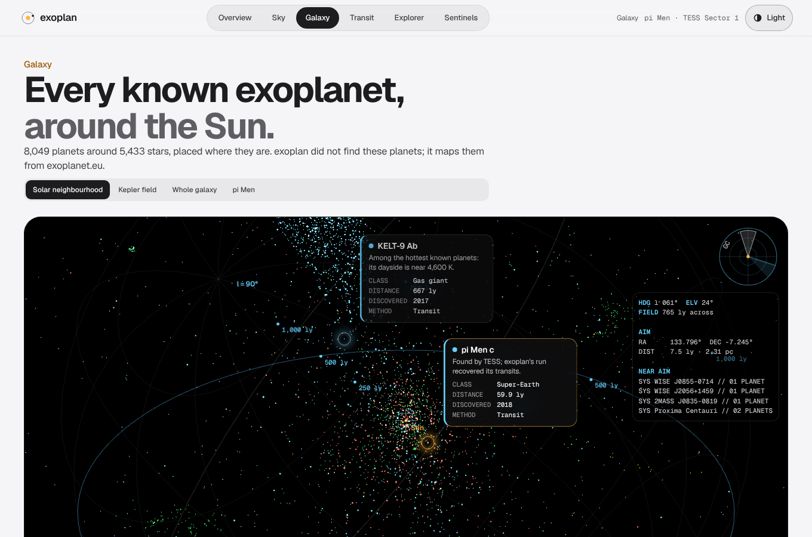
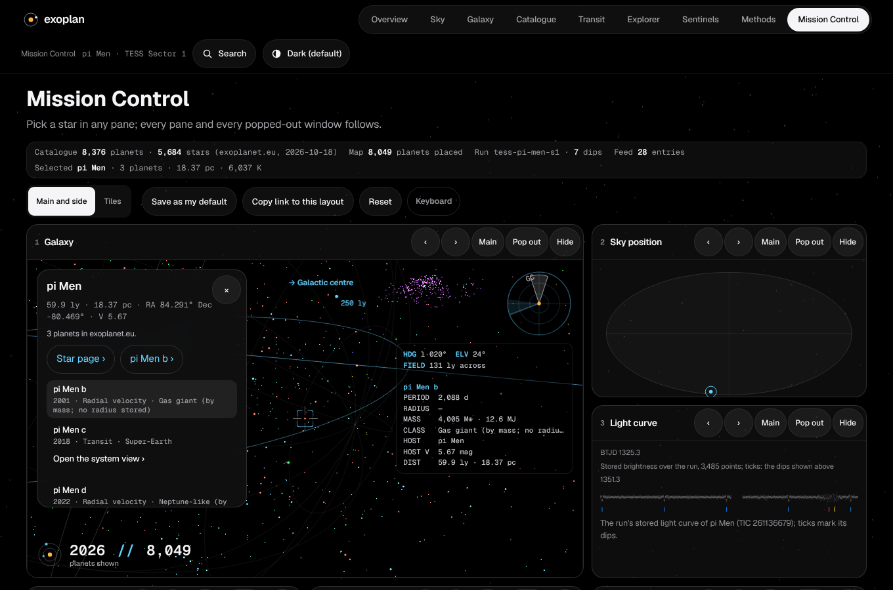
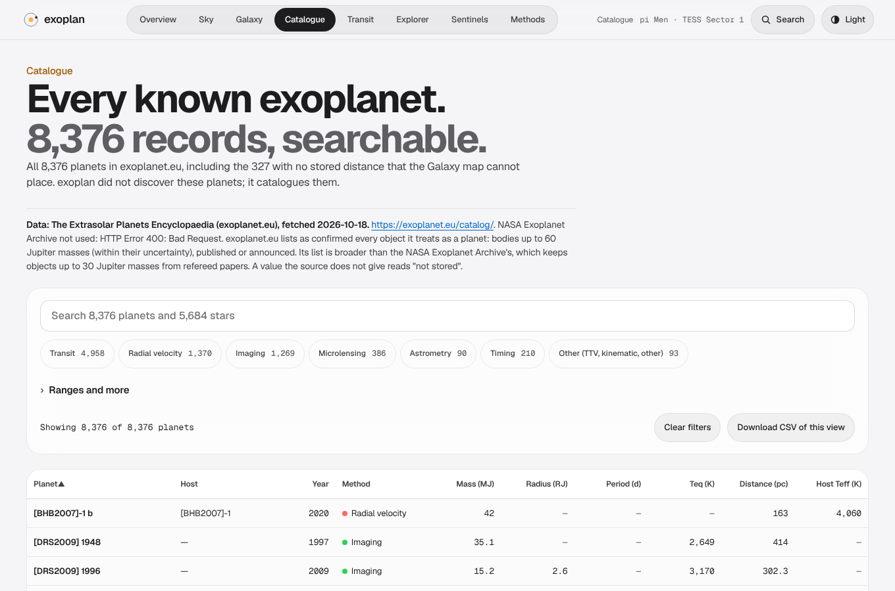
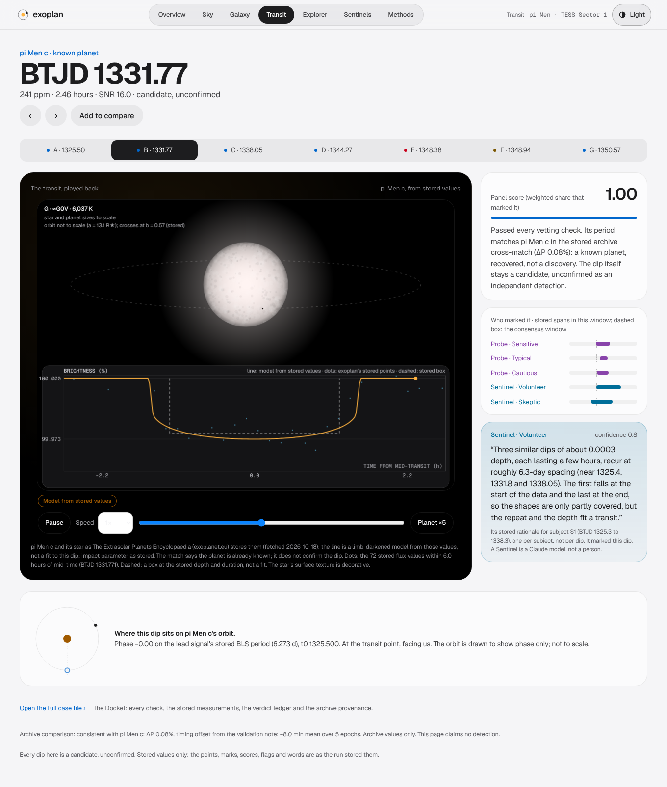
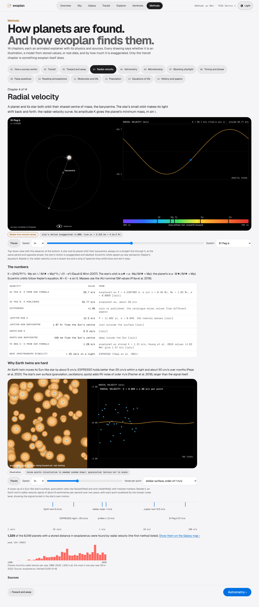
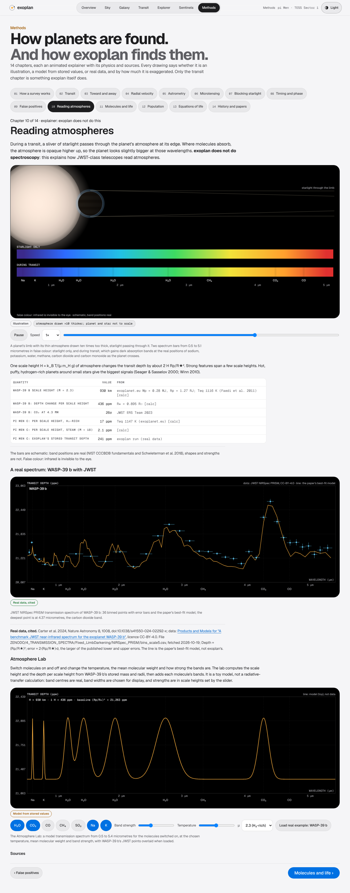
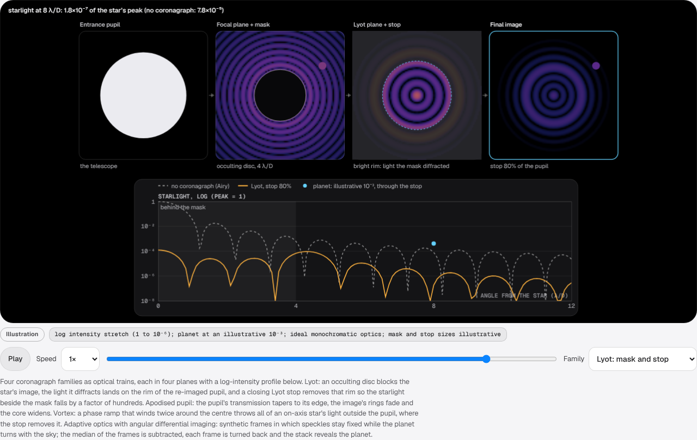
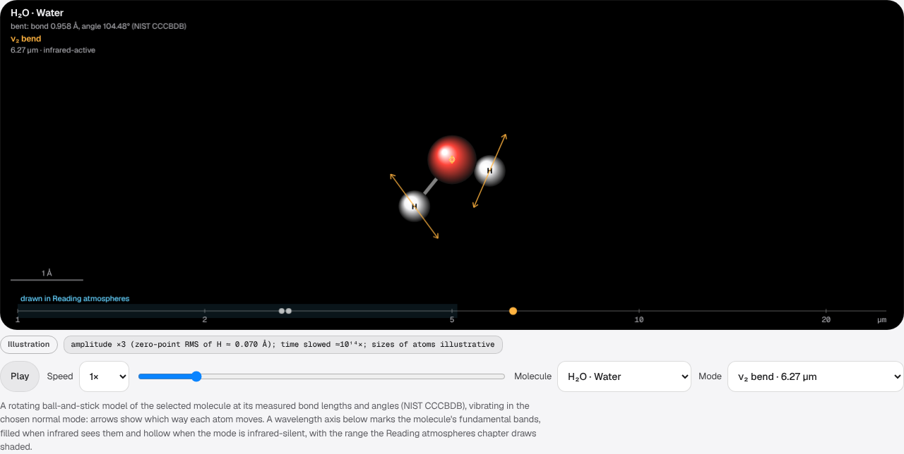

<!-- The screenshots under docs/assets/readme/app/ were taken from the built site by the review
     probes (headless Chromium, 1360 px wide, light and dark). At the public release they will be
     regenerated by tools/gen_readme_assets.py and checked in CI, as in Kshana. The Setu mark
     comes from the Setu brand kit (brand/svg/setu-mark.svg). -->

<p align="center">
  <picture>
    <source media="(prefers-color-scheme: dark)" srcset="docs/assets/readme/setuhq-logo-dark.svg">
    <source media="(prefers-color-scheme: light)" srcset="docs/assets/readme/setuhq-logo-light.svg">
    
  </picture>
</p>

<p align="center">
  <strong>SetuHQ · <span lang="sa">सेतु</span> · <em>the bridge</em></strong><br>
  The open exoplanet observatory: from public sky data to reviewed, explained candidates.
</p>

<p align="center">
  <a href="scripts/ci_local.sh"></a>
  <a href="#evidence"></a>
  <a href="#the-app"></a>
  <a href="#the-app"></a>
  <a href="#licence"></a>
  <a href="#editions"></a>
</p>

<p align="center">
  <a href="https://setuhq.com"><b>setuhq.com</b></a> ·
  <a href="#the-app">The app</a> ·
  <a href="#how-a-run-works">How it works</a> ·
  <a href="#evidence">Evidence</a> ·
  <a href="#quick-start">Quick start</a> ·
  <a href="#editions">Editions</a> ·
  <a href="#cite">Cite</a>
</p>

<picture>
  <source media="(prefers-color-scheme: dark)" srcset="docs/assets/readme/app/galaxy-dark.png">
  <source media="(prefers-color-scheme: light)" srcset="docs/assets/readme/app/galaxy-light.png">
  
</picture>

> **Preview.** This README is the draft for the public release. The product is being renamed
> from *exoplan* to **SetuHQ**: the Python package and the command are still `exoplan` until the
> release lands. Nothing on this page is a discovery claim: SetuHQ finds and vets *candidates*.

## Every dip in the sky, reviewed and explained

TESS has watched about 98% of the sky. Almost all of that light is public, and almost none of it
has been looked at dip by dip. SetuHQ does the looking: a **reviewer panel** of AI **Sentinels**
and deterministic **Probes** marks every dip in blind-coded light curves, the way Planet Hunters
volunteers do. Each verdict keeps its marks, its weights and, for the Sentinels, their reasons
in words. Then the pipeline does the physics: limb-darkened transit fits, bounded false-alarm
probabilities, odd/even and secondary checks, and an honest label on everything.

*Sentinels run on Claude (Anthropic). Probes are deterministic matched-filter detectors.*

**What SetuHQ is built to be:**

- **A search you can audit.** Every candidate carries its provenance: data hash, config hash,
  code fingerprint, every reviewer's marks.
- **A benchmark that keeps everyone honest,** including SetuHQ. A frozen, blind test on 662 real
  TESS candidates, with controls, a public leaderboard and its negative results printed first.
- **An observatory you can explore.** Every known exoplanet in 3D, a full catalogue, and
  fifteen animated chapters on how planets are found, all in one app.

## The app



<table>
<tr>
<td width="50%">

<picture>
  <source media="(prefers-color-scheme: dark)" srcset="docs/assets/readme/app/catalogue-dark.png">
  <source media="(prefers-color-scheme: light)" srcset="docs/assets/readme/app/catalogue-light.png">
  
</picture>

**Catalogue.** All 8,376 exoplanet.eu records, 5,684 stars, a page for every one, and search
from anywhere (⌘K).

</td>
<td width="50%">

<picture>
  <source media="(prefers-color-scheme: dark)" srcset="docs/assets/readme/app/transit-dark.png">
  <source media="(prefers-color-scheme: light)" srcset="docs/assets/readme/app/transit-light.png">
  
</picture>

**Transit cases.** SetuHQ’s own dips, with the stored points, the limb-darkened fit and each
reviewer’s marks.

</td>
</tr>
<tr>
<td width="50%">

<picture>
  <source media="(prefers-color-scheme: dark)" srcset="docs/assets/readme/app/rv-dark.png">
  <source media="(prefers-color-scheme: light)" srcset="docs/assets/readme/app/rv-light.png">
  
</picture>

**Methods: 15 chapters.** Transit, Doppler, radial velocity, astrometry, microlensing,
imaging, atmospheres, molecules, timing, false positives, population, radio, equations of life,
history. Physics checked by tests against closed forms and published values.

</td>
<td width="50%">

<picture>
  <source media="(prefers-color-scheme: dark)" srcset="docs/assets/readme/app/jwst-dark.png">
  <source media="(prefers-color-scheme: light)" srcset="docs/assets/readme/app/jwst-light.png">
  
</picture>

**Real data, labelled.** The real JWST spectrum of WASP-39 b (CO₂ at 4.37 µm), and an
Atmosphere Lab. Every visual says whether it is real data, a model or an illustration.

</td>
</tr>
<tr>
<td width="50%">

<picture>
  <source media="(prefers-color-scheme: dark)" srcset="docs/assets/readme/app/coronagraph-dark.png">
  <source media="(prefers-color-scheme: light)" srcset="docs/assets/readme/app/coronagraph-light.png">
  
</picture>

**Coronagraphs, computed.** Lyot, apodised pupil, vortex and adaptive optics with angular
differential imaging, from real Fraunhofer numerics.

</td>
<td width="50%">

<picture>
  <source media="(prefers-color-scheme: dark)" srcset="docs/assets/readme/app/molecules-dark.png">
  <source media="(prefers-color-scheme: light)" srcset="docs/assets/readme/app/molecules-light.png">
  
</picture>

**Molecules, mode by mode.** Ten molecules, each vibration linked to its infrared band,
infrared-silent modes marked.

</td>
</tr>
</table>

## How a run works

```mermaid
flowchart LR
  A["TESS / CHEOPS light curve<br/>(MAST, FITS, CSV)"] --> B["Clean · detrend · bin"]
  B --> C["Blind-coded 13-day subjects<br/>(no target names)"]
  C --> D["Reviewer panel<br/>Sentinels + Probes"]
  D --> E["Skill-weighted consensus"]
  E --> F["Vetting<br/>SNR · odd/even · secondary · edges"]
  F --> G["Limb-darkened fit<br/>depth · T14 · b · ρ★"]
  G --> H["Bounded FAP<br/>block bootstrap"]
  H --> I["Candidates with provenance<br/>CSV · JSON · site"]
```



<details>
<summary><b>Step by step</b></summary>

<br>


1. **Ingests** TESS SPOC light curves from MAST, CHEOPS light-curve FITS files, or CSV.
2. **Cleans and detrends**: spike clipping, a masked local-quadratic baseline, and binning.
3. **Cuts blind-coded subjects**: fixed 13-day segments with opaque IDs. The target name never reaches a reviewer.
4. **Runs the panel**: every reviewer marks and labels every subject independently. The task is the Planet Hunters task: mark the start and end of each dip, then label `potential_planet` or `noise`.
5. **Aggregates** marks by single-linkage clustering, scores each dip by the share of skill-weighted reviewers who marked it, and requires the panel to call the subject a potential planet.
6. **Vets** each consensus event: SNR, duration, edge effects, odd/even depth, secondary eclipse, and fit to the periodic ephemeris.
7. **Writes** a candidate catalogue (CSV and JSON), a Zooniverse-shaped classification export, a SQLite store, a provenance manifest, and a static report site.

</details>

<details>
<summary><b>The reviewer panel: Sentinels and Probes</b></summary>

<br>

| Reviewer kind | Shown as | What it is | Needs |
|---|---|---|---|
| `simulated` | **Probe** | Deterministic matched-filter detector with human-like limits (threshold, miss rate, boundary jitter). A baseline and a calibration reference. | Nothing |
| `claude_code` | **Sentinel** | Claude reviewing the rendered plot through the **Claude Code CLI**, which signs in with a Claude team or individual subscription. | `claude` on PATH, signed in |
| `claude` | **Sentinel** | Claude through the **Anthropic API** (vision). | `ANTHROPIC_API_KEY` |

The pages show display names; reviewer ids stay unchanged in every data file, CSV, JSON
and URL. The default panel is 2 Sentinels and 3 Probes: Sentinel · Volunteer
(`claude-volunteer`), Sentinel · Skeptic (`claude-skeptic`), and Probe · Sensitive,
Probe · Typical and Probe · Cautious (`volunteer-sensitive`, `volunteer-typical`,
`volunteer-cautious`).

Sentinels receive the same task as volunteers, the blind-coded plot, and no
target name. They return strict JSON, which is validated and clipped to the subject's
time range. A reviewer that is not available is skipped and listed in the manifest.
Responses are cached by a hash of model, prompt and image, so re-runs are free and
reproducible.

The two Sentinels use two personas: `volunteer` (careful, marks dips) and `skeptic`
(rejects binary and systematic signatures unless they are clear).

</details>

## Evidence

SetuHQ reports what it measured, including where it falls short.

| Measure | Result | Source |
|---|---|---|
| pi Men c, Rp/R★ against Huang et al. 2018 | **1.05** (0.0179 ± 0.0017) | [validation](docs/results/pi_men_validation.md) |
| pi Men c, transit duration T14 | **1.04** (3.07 ± 0.17 h) | [validation](docs/results/pi_men_validation.md) |
| Real-TOI benchmark, held-out completeness | **57%** (86/150; 49–65%) | [benchmark](docs/results/benchmark_real_tois.md) |
| … planets below 2 R⊕ | 10% | [benchmark](docs/results/benchmark_real_tois.md) |
| Live feed’s “new” signals | **consistent with noise** under the old rule (≈13 per 100 targets from controls vs 15.8 observed). The pre-registered two-sector rule cuts held-out noise from 23.0 (18.6–28.0) to 6.1 (4.0–9.4) per 100 targets, still far above the 0.3 real new signals per 100; re-run under it, 0 of the 3 earlier new signals survive | [validation](docs/results/feed_rule_validation.json) |

<details>
<summary><b>Results in full</b></summary>

<br>

Real data, TESS SPOC sector 1 of pi Men (TIC 261136679), the three Probes plus the two
Sentinels (Skeptic and Volunteer, on Claude via the CLI):

* 6 consensus dips, 6 passed vetting, one of them flagged `off_ephemeris`.
* Five of them lie on the published pi Men c ephemeris. All five predicted epochs in the
  25-day window are recovered, with a mean timing offset of -8 minutes against the
  NASA Exoplanet Archive value.
* **Transit shape, limb-darkened fit** (re-vetted from the stored classifications; see
  [docs/results/pi_men_validation.md](docs/results/pi_men_validation.md)). A joint fit of
  the five epochs, with the period free near the BLS period (6.2680 ± 0.0005 d; Huang:
  6.26790 d), gives the like-for-like quantities first: **Rp/R★ = 0.0179 ± 0.0017 (1.05 against
  Huang et al. 2018) and T14 = 3.07 ± 0.17 h (1.04)**. The mid-transit depth of the
  limb-darkened model is 292 ± 8 ppm (0.97 against Huang's published 300 ppm, which is
  defined by that paper, not by this model). The box measure it replaces gave 0.81 in depth
  and 0.64 in duration. Errors are conservative: the covariance plus the spread along the
  impact-parameter profile.
* **The impact parameter needs the star.** Free, five TESS transits give only b < 0.87 (1σ),
  so a/R★ and ρ★ are ranges (ρ★ 0.28 to 2.2 g/cm³ at 1σ, consistent with the TIC's 1.02). With
  the TIC density as a Gaussian prior (1.02 ± 0.20 g/cm³), the fit gives b = 0.64 ± 0.12,
  a/R★ = 12.85 (1σ 11.5 to 13.6) and T23/T14 = 0.95, against Huang's 0.59, 13.38 and 0.95. The
  fit is U-shaped, not V-shaped.
* The periodic signal's false-alarm probability is below 10⁻⁴ in both subjects. No one of
  10,000 block-bootstrap trials reached the observed SNR, so 10⁻⁴ is a bound, not a value. The
  null maxima are committed in `runs/tess-pi-men-s1/fap_null/`; a Gumbel fit to them, stored
  as `fap_tail`, puts the tail below 10⁻⁶ (indicative only, see below).
* The sixth passed event (BTJD 1348.9, 0.87 h, SNR 9.5) does not fit the ephemeris and
  is a likely false positive. It is kept and flagged, not hidden.

**What the Sentinels did in this run, reported as found:**

* On the second subject, both Sentinels independently marked the two real
  epochs at BTJD 1344.3 and 1350.55 (about 6.2 days apart). They rejected the spurious
  1348.9 dip, with sound reasons.
* On the first subject, both Sentinels called the real epochs at BTJD 1325.5,
  1331.8 and 1338.05 "instrumental" edge ramps and missed them. The Probes found
  them. Those dips sit near the segment start and end, which is a known weak spot for
  a reviewer that reads edges as systematics. This is exactly why the Sentinels are
  voices in a calibrated panel, not the whole panel.

**Blind benchmark on real TOIs** (measured on a stated benchmark, not discoveries; see
[docs/results/benchmark_real_tois.md](docs/results/benchmark_real_tois.md)). 662 TOIs from the NASA
Exoplanet Archive TOI table (fetched 2026-10-19, seed 20261019): 300 CP/KP, 300 FP and 62 FA, one per
star, split into halves by star. Each star's first SPOC 2-minute sector goes through the Probes panel,
along with a flux-inverted and a block-scrambled copy as false-alarm controls. Held-out half, with Wilson
95% intervals:

* **Completeness: 57% (86 of 150 CP/KP on searchable stars; 49 to 65%).** It is 80% above 8 R⊕,
  23% at 2 to 4 R⊕ and 10% below 2 R⊕. The references are Kepler's Robovetter (above 85%) and
  Planet Hunters TESS (85% above 4 R⊕, 51% at 3 to 4 R⊕).
* FP TOIs: the panel found the dip of 77% and rejected or flagged 68% of those as binary-like.
  This applies to FP stars with 2-minute data only (124 of 158). FP TOIs are far more often
  FFI-only, so this is not reliability on the whole FP list.
* **The live feed's "new" signals are consistent with noise.** On the controls, the feed's own
  admission rule passes 55 (inverted) and 65 (scrambled) false signals per 1,000 star-sectors.
  That is about 13 per 100 targets reviewed, against 15.8 per 100 on the live feed (3 over 19
  targets).
* **The fix, pre-registered and tested once.** The feed now requires the signal in both reviewed
  sectors (periods within 0.5%) and a FAP below 0.001 over 2,000 trials. The rule was chosen on the
  tuning half and committed (8909cda) before one held-out evaluation. Held-out results, measured with
  the discovery config, old rule to new rule:
  * noise from the controls: 23.0 (95% CI 18.6–28.0) to 6.1 (4.0–9.4) false signals per 100 targets;
  * feed-level completeness: 39% to 17%;
  * FP TOIs kept out: 73% to 94%.

  Noise drops about fourfold, but 6 per 100 targets is still far above the 0.3 new signals per 100
  that real light curves give. The feed is still dominated by false alarms, and an admission is a
  lead for human or follow-up review, not a candidate of any confirmed status. Re-run under the new
  rule, the live feed's 19 targets keep 0 of the 3 earlier new signals and admit 2 known TOIs.
* The Sentinels on a stated subsample of 40 held-out stars: each persona marked 50% of the CP/KP
  dips and 20% of the FP dips as potential planets. They agree on 38 of 40 stars (φ = 0.89):
  one model, so one correlated voter.

Injection-recovery benchmark for the Probes:
[docs/results/injection_recovery_simulated_panel.md](docs/results/injection_recovery_simulated_panel.md).
The Sentinels are not in the benchmark. Each injected subject would need its own CLI
call, so the Sentinels are calibrated separately on a small sample (10 injected and 10
empty subjects: weight 0.5 each, against 0.4 to 0.6 for the Probes).

</details>

<details>
<summary><b>Continuous discovery and what it can claim</b></summary>

<br>

`exoplan discover` runs one batch of TESS targets. It rotates through the TOI host list
so coverage advances each day, reviews the two latest sectors of each target, and keeps
every new dip in a deduplicated catalogue. A dip is `known_toi` when it matches a
published TOI period, and `new_candidate` otherwise.

- [`.github/workflows/discover.yml`](.github/workflows/discover.yml) runs a batch every six hours
  on the self-hosted runner, commits the catalogue, and deploys the site. Claude's API reviewer
  runs when the `ANTHROPIC_API_KEY` secret is set.
- [`scripts/improve.py`](scripts/improve.py) sweeps panel thresholds on injection benchmarks.
  It promotes a setting only if it wins on a held-out seed. Every trial is in
  [docs/leaderboard.md](docs/leaderboard.md), including losers.

**Measured false-alarm rate.** Under the earlier rule (FAP < 0.01 over 200 trials, one sector),
light curves with every signal destroyed passed about 13 noise signals per 100 targets. The live
feed showed 15.8 `new_candidate` signals per 100 targets, so its "new" signals were consistent
with noise (see [the benchmark](docs/results/benchmark_real_tois.md)).

The feed now requires the signal in both reviewed sectors and a FAP below 0.001 over 2,000 trials.
That rule was chosen on the tuning half, pre-registered, and evaluated once on the held-out half
([validation](docs/results/feed_rule_validation.json)). It lowers noise about fourfold, to 6.1 per
100 targets (95% CI 4.0–9.4), and roughly halves completeness. Noise still outweighs the real new
signals by far, so the feed's admissions are leads for human or follow-up review.

Re-run under the new rule (the TOI table was cached on 2026-10-19 because the Archive returned HTTP
526), the 19 live targets keep 0 of the 3 earlier new signals. The earlier catalogue is kept in
[docs/discoveries/catalog_v1_fap200.json](docs/discoveries/catalog_v1_fap200.json).

**What this can and cannot claim.** Every entry is a candidate. A detection here means the
pipeline saw a vetted dip that matches no published ephemeris. It does not mean a planet has
been found. Confirmation needs radial velocities, ground-based photometry, or the
community's TESS follow-up. The pipeline also has no centroid or pixel check, so blended
eclipsing binaries can survive vetting. The claim this project can defend is a reproducible,
calibrated search with open provenance. It is not a claim of new planets or of beating
published pipelines.

</details>

<details>
<summary><b>Honest limits</b></summary>

<br>

* **The Sentinels are calibrated on a small sample only.** The full benchmark needs many
  CLI or API calls. See the calibration file for the sample size used.
* **Synthetic results are not sky results.** The benchmark uses white plus red noise. It
  measures the pipeline's logic, not real completeness.
* **The CHEOPS column mapping is unverified.** The loader accepts several candidate
  names and records the ones used. Check them against a real `SCI_COR_Lightcurve` file.
* **Transit fits are light-curve fits.** Every consensus dip gets a limb-darkened fit (Claret
  2017 TESS coefficients from the TIC's Teff and log g) with depth, T14, impact parameter and
  mid-time with errors, a ρ★ consistency check and a V-shape test. On a periodic signal the
  period is fitted too, near the BLS period, so an approximate search period does not smear
  the epochs. With a few TESS transits the impact parameter, and so a/R★ and ρ★, is poorly
  constrained: b is then printed as an upper limit and ρ★ as a range, and a second fit with
  the TIC density as a prior is stored beside the free one. The density band (0.3 to 3
  times the catalogue value, at 3σ) is illustrative, not a published threshold.
* **False-alarm probabilities are bounded by the trials.** A FAP is (k + 1)/(N + 1) over N
  block-bootstrap trials, and is never printed below 1/(N + 1). The stored pi Men run uses
  10⁴ trials, the discovery batches 2,000 (stopped once 2 trials reach the signal's SNR), and the
  library default 20. The feed's FAP < 0.001 rule passes at k ≤ 1 of 2,000, which by itself still
  admits about N/1,000 noise signals across N targets. The two-sector part of the rule is what
  removes most of the rest. A Gumbel fit to the null
  maxima is stored with each candidate (`fap_tail`, with `fap_exceed` and `fap_method`). It
  is indicative, extrapolated beyond the trials and conservative (BLS maxima are
  lighter-tailed than Gumbel), and it is never given below 10⁻⁶.
* **Vetting uses only light curves.** There is no centroid or pixel-level check, so
  blended eclipsing binaries can pass.
* **Edge events are the weak spot** for both the statistics and the reviewers.
* **Feed admissions are leads, not candidates of any confirmed status, and the feed is still
  dominated by false alarms.** Nothing on the discovery feed is a confirmed planet. Under the
  pre-registered two-sector rule, noise alone still gives about 6 false signals per 100 targets
  (held-out, 95% CI 4.0–9.4). That is far above the 0.3 per 100 that real light curves give.
  The rule also costs completeness (feed level, held-out: 39% to 17%).
* **Real-TOI completeness is 57% on searchable stars** (held-out; 49 to 65%), well below published
  vetters, and only 10% for planets below 2 R⊕. The FP measures cover only FP stars with 2-minute
  data, a population skewed away from the full FP list.
* **Known bug in the code that produced the benchmark: preprocess clipping.** `preprocess.clean`
  removes every point more than 10× the point-to-point scatter below the running median, with no
  run-length test. Transits deeper than about 10× the per-cadence scatter therefore lose their
  in-transit points. In the held-out half, 27 CP/KP and 11 FP stars are exposed (depth more than 8×
  the scatter), and 3 CP/KP misses are explained by it. Completeness is 53% (65/123) with those
  stars excluded. A fix is on a separate branch; after it merges, only the affected stars will be
  re-run and reported as an update.

</details>

**In review for this release** (on branches, each scored by an independent reviewer):
pixel-level and Data-Validation-style vetting, a reduced false-positive probability with a
stability gate, ExoFOP-style export (accepted, 9.0/10); a methods paper and a public
leaderboard with a catalogue-metadata floor that SetuHQ does not yet beat (accepted, 9.0/10);
the “everything that dims” catalogue and an all-sky sweep with contributor bundles (in review).

## What it is / is not

| SetuHQ is | SetuHQ is not |
|---|---|
| a reproducible, calibrated transit search on public data | a source of confirmed planets |
| a blind benchmark with controls and a public leaderboard | a claim to beat published pipelines |
| an explorer of every known exoplanet, with sourced numbers | a replacement for follow-up observations |
| explainable: every verdict keeps its marks and reasons | a black box |

## Quick start

> The package and command are still named `exoplan`; they become `setuhq` in the release.

```bash
pip install -e ".[tess,dev]"         # add ,claude for the API backend
pytest -q                            # offline tests (one network-marked test is deselected)

exoplan run configs/tess_pi_men_s1.toml --out runs/tess-pi-men-s1
exoplan rebuild runs/tess-pi-men-s1 configs/tess_pi_men_s1.toml   # re-vet from the stored classifications
exoplan report runs/tess-pi-men-s1 --out site --validation docs/results/pi_men_validation.md
exoplan calibrate configs/tess_pi_men_s1.toml --out weights.json
exoplan benchmark configs/benchmark_simulated_panel.toml --weights weights.json --out bench.md
pytest -q -m network                 # live MAST download test
```

Configs are documented in [configs/default.toml](configs/default.toml). Every value
that changes a result is in the config, and its hash goes into the manifest.


## Contribute a sweep

Soon: run SetuHQ on a TESS sector with your own Claude subscription, send a sealed bundle, and
get credit on every entry you bring. The design is in review; the guide will be in
`CONTRIBUTING.md`. Keys never go in a file or a message: environment variables only.

## Editions

The whole of SetuHQ is open. Paid routes start with a message; there are no prices here.

| | Free | SetuHQ Pro | Custom study |
|---|---|---|---|
| What it is | all of open SetuHQ, no feature gate | a proprietary overlay on the same open engine, under contract | a study done for you, under contract |
| Licence | AGPL-3.0-only, or a commercial licence | proprietary | contract |
| Status | available | **planned, available on request** | on request |
| How to start | [quick start](#quick-start) or [setuhq.com](https://setuhq.com) | [request an evaluation](mailto:contact@ashforde.org?subject=SetuHQ%20Pro%20evaluation) | [request a study](mailto:contact@ashforde.org?subject=SetuHQ%20custom%20study) |

SetuHQ Pro will be a strict superset that depends on open SetuHQ and never forks it. It adds no
new science: every Pro number comes from the open pipeline, and nothing Pro produces confirms or
validates a planet. Directions under consideration, none of them built: hosted sweeps at scale,
private target lists and embargoed candidates, team workspaces, supported on-premises
deployment, and priority follow-up export.

## Repository layout

```
src/exoplan/
  lightcurve.py   container with provenance      loaders.py   TESS (MAST), CHEOPS FITS, CSV
  preprocess.py   clean, detrend, bin            subjects.py  blind-coded 13-day segments
  search.py       BLS and single-event search    vet.py       automatic vetting
  injection.py    synthetic transits              calibrate.py skill-based reviewer weights
  aggregate.py    clustering and consensus       pipeline.py  end-to-end run
  benchmark.py    injection recovery             report.py    static HTML site
  store.py        SQLite and CSV export          config.py    TOML configs
  reviewers/      simulated, claude (API), claude_code (CLI)
configs/          run configs                    scripts/     known-planet validation
docs/             research notes and results     site/        generated report
tests/            offline tests, plus a network test marked "network"
```

## Cite

A methods paper and a `CITATION.cff` come with the release. Until then, cite the repository and
the commit you used.

## Licence

Code: **AGPL-3.0-only** from the public release, or a commercial licence from Ashforde OÜ
(dual licensing, explained in `LICENSING.md` at release; the current `LICENSE` file is still MIT
and switches with it). Data, benchmark and paper: **CC BY 4.0**. “SetuHQ” and the Setu mark are
trademarks of Ashforde® OÜ; forks must use another name.

<p align="center"><sub>SetuHQ · सेतु · the bridge — built by Ashforde OÜ. Sentinels run on Claude (Anthropic). Probes are deterministic matched-filter detectors.</sub></p>
